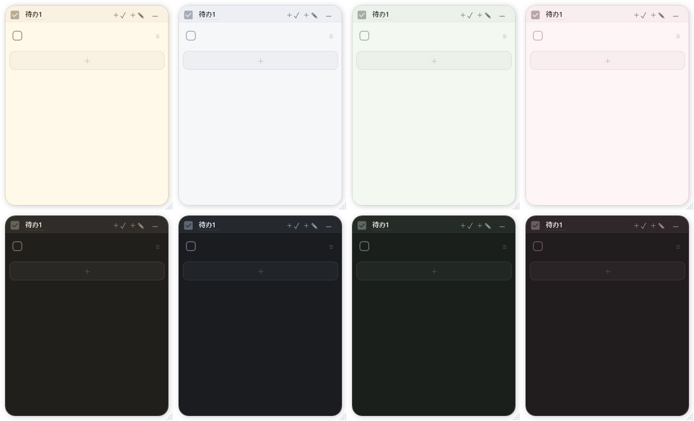
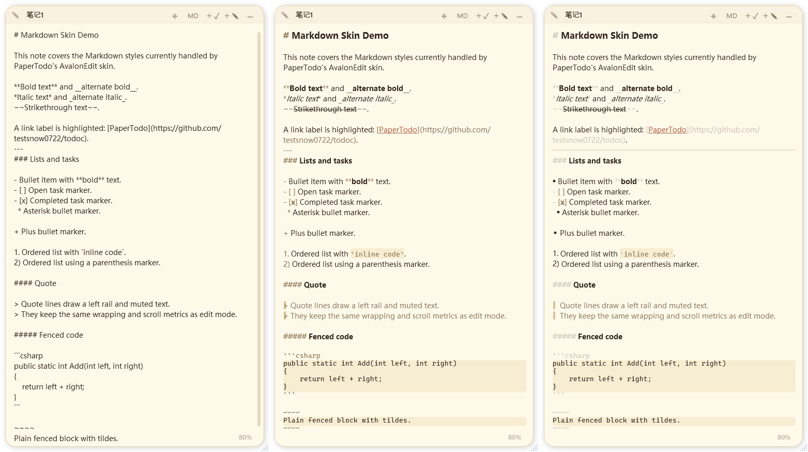
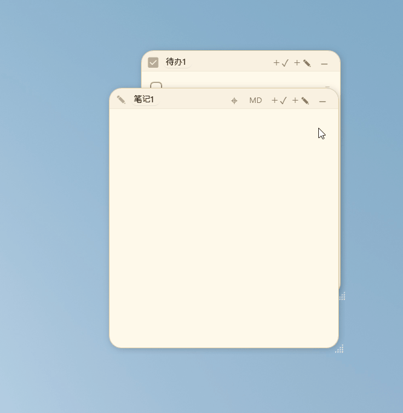
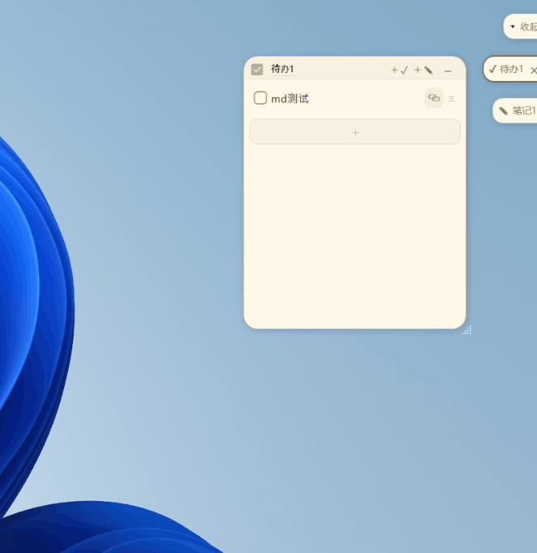

<div align="center">

# PaperTodo · 一张纸

**让桌面上有几张安静、可用、不打扰人的纸。**

一个以 Windows 桌面纸片为核心的轻量便签工具，使用 WPF 原生界面。可选大纲显示、跨端同步和 Android 伴侣端，无需注册账号。

   

**语言：中文 | [English](README.en.md)**

[GitHub 源码](https://github.com/A-LIGE-Z/papertodo) · [发布记录](https://github.com/A-LIGE-Z/papertodo/releases)

</div>

---

## 预览

| 纸片 |
| :---: |
|  |

| Markdown 浏览 |
| :---: |
|  |

| 胶囊模式 | 高级胶囊 |
| :---: | :---: |
|  |  |
| 纸片可折叠为小胶囊，减少桌面占用。 | 折叠胶囊自动贴到屏幕边缘，悬浮时滑出。 |

---

## 设计理念

- **纸片优先** — 每张纸都是独立的无边框窗口，也可以切换到大纲显示。
- **即时使用** — 想记就写，完成就勾掉；位置、尺寸、置顶、内容都自动保存。
- **保持轻量** — 不做账号、分类、标签和归档系统；同步、到期提醒与大纲显示按需使用。
- **原生实现** — 基于 WPF，不使用 WEB套壳，也不走 MSIX 复杂权限管理。
- **交互优先** — 轻不是低占用洁癖，而是操作路径轻、认知负担轻、界面干扰少。

> 拒绝长出非必要的交互层级和视觉焦点负担。

---


## 项目特色

- **多张独立纸片** — 每张纸是一个独立窗口。
- **一个应用，两种纸片**：
  - **待办纸**：一行一个事项，可以勾选、编辑、删除、清理已完成。
  - **笔记纸**：普通文本 + MD语法轻量高亮，支持三档 MD 伪渲染。
- **胶囊模式**（默认启用）— 点击纸片右上角可折叠成置顶小胶囊，减少桌面占用，需要时点击唤回。
- **胶囊自动贴边**（默认启用）— 折叠胶囊自动贴边排列；支持多屏，拖动单个胶囊就能换边或挪到别的屏幕。
- **交互层级最优化** — 常用操作大多一两步可达，不必层层点开。
- **脚本胶囊** — 笔记首行写入 `!p` / `!power` ，可快捷运行笔记中的脚本，充分发挥胶囊管理系统能力
- **待办关联笔记** — 可把笔记拖到待办项上建立关联；可直接打开关联笔记。
- **主题切换** — 支持跟随系统 / 浅色 / 深色三种模式。
- **五套配色方案** — 默认思源配色，保留暖纸、墨、林、霞与自定义颜色。
- **多语言界面** — 中文、英文、日文、韩文，跟随系统语言。
- **开机自启动** — 可随 Windows 启动后台运行。
- **自定义图标** — 程序目录存在 `PaperTodo.ico` 时优先作为托盘图标，否则用内嵌图标。
- **数据安全** — 自动保存到程序目录 `data.json`，保留 `data.backup.json`；临时文件写入降低异常退出时的损坏风险。
- **原生纸片体验**：使用 WPF 原生控件实现，优雅高效流畅。
- **快捷参数启动**：通过启动参数即可显示、隐藏、切换和新建纸片，方便用快捷键工具或脚本调用。

---

## 纸片功能与操作手册


## 纸片

**基本操作**

- **移动与缩放**
- **置顶**：左上角的类型图标同时也是置顶开关
- **新建**：右上角可新建待办和笔记纸
- **外部编辑器打开**：点击 `MD` 按钮，用外部编辑器打开当前笔记（后缀可在设置中自定义）
- **设置标题**：可自定义纸片标题

**胶囊与贴边**

- **折叠胶囊**：纸片可折叠为置顶小胶囊，减少桌面占用，可便捷再次打开。
- **自动贴边**：折叠胶囊可自动停靠在屏幕边缘，悬浮时滑出。
- **多屏队列**：可把单个贴边胶囊拖到左侧、右侧或其他显示器，松手后自动加入对应屏幕边缘队列。
- **收起全部**：顶部主胶囊可一键收起 / 展开全部贴边胶囊，也可拖动调整所在队列的起始高度。


---

### 待办 (Todo)

适合当天任务、临时事项、桌面小清单。

**基本操作**

- **勾选完成**
- **新增事项**
- **拖动排序** — 按住右侧 `≡` 手柄上下拖动
- **拖拽删除** — 拖动事项到底部删除
- **粘贴多行** — 自动拆成多条事项，并清洗常见列表前缀
- **视觉大小** — 可在设置中选择小 / 中 / 大 / 特大四档显示大小
- **撤销 / 重做** — `Ctrl+Z` / `Ctrl+Y`

**关联笔记**：可把一张笔记从顶栏拖到待办项上建立关联。关联后，待办项后方会显示打开入口；开启“关联笔记显示名称”后，会显示笔记标题。

---

### 笔记纸 (Paper)

笔记纸不是 Markdown 编辑器，只是让一张纸能写得稍微清楚一点。

**格式快捷键**

- `Ctrl+B` — 加粗。
- `Ctrl+I` — 斜体。
- `Ctrl+K` — 插入超链接。
- `Ctrl+Z` / `Ctrl+Y` — 撤销 / 重做。
- `Ctrl + 滚轮` — 按 10% 步进缩放正文文字（点击右下角百分比恢复 100%）。

**支持的 Markdown**：标题 `#`～`######`、加粗 `**文本**`、斜体 `*文本*`、删除线 `~~文本~~`、无序列表 `-`、有序列表 `1.`、引用 `>`、分割线 `---` / `***` / `___`、行内代码 `` `code` ``、代码块 ` ``` `、超链接 `[文本](URL)`，以及少量单行内联 HTML 标签（`b/strong/i/em/s/del/u/code/a href`）。

**不支持**：图片、表格、附件、嵌入内容、块级 HTML、复杂块编辑器。

**外部编辑**：顶栏 `MD` 按钮可用系统默认 `.md` 编辑器打开临时文件

**自定义后缀**：顶栏 `MD` 按钮可改为 `.txt`、`.html`、`.bat` 等系统已关联后缀，由 Windows 关联程序处理临时文件。

**脚本胶囊**：笔记第一行写入 `!p` / `!power` 后，后续内容会作为 PowerShell 脚本运行。折叠成胶囊后显示闪电图标，左键运行，右键打开纸片继续编辑；使用 `!pf` / `!powerf` 可投递到常驻 PowerShell 进程。


---
## 设置

- **外观** — 主题、配色方案、待办视觉大小、标题最大字数、普通悬浮提示和动画开关。
- **全屏置顶策略** — 检测到外部全屏窗口时，可选择纸片和贴边胶囊临时避让，或保持在全屏画面之上。
- **待办与笔记** — 待办关联笔记、关联笔记显示名称、已关联笔记是否显示为胶囊。
- **顶栏按钮** — 可单独隐藏新建待办、新建笔记和外部打开按钮。
- **外部打开** — 自定义笔记临时文件后缀，用系统默认编辑器打开当前笔记。
- **脚本胶囊** — 优先使用 PowerShell 7、隐藏脚本运行窗口、启用常驻 PowerShell 进程。
- **胶囊** — 胶囊模式、自动贴边、多屏左右队列、展开时保留边缘胶囊、收起全部主胶囊。

---

## 托盘入口

PaperTodo 没有主窗口。托盘是唯一的全局入口。

### 托盘操作

- **双击托盘图标** — 显示并拉回全部纸片。
- **右键托盘图标** — 打开菜单（顶部显示当前版本号）。
- **设置** — 打开独立设置弹窗，集中主题、配色、MD 解析、自启动、顶栏按钮、待办关联笔记和胶囊选项。
- **删除纸片** — 列表行右侧 `×` 先切换为确认态，再选择「确认 / 取消」。

### 启动参数

可配置到外部快捷键工具、脚本或 Windows 快捷方式：

```text
PaperTodo.exe --show       显示并拉回全部纸片
PaperTodo.exe --hide       隐藏全部纸片（程序继续在托盘运行）
PaperTodo.exe --toggle     有显示则隐藏全部，全部隐藏则显示
PaperTodo.exe --new-todo   新建一张待办纸
PaperTodo.exe --new-note   新建一张笔记纸
PaperTodo.exe --exit       保存状态并退出
```

参数可省略 `--`，并支持少量别名（如 `open` = `show`，`quit` = `exit`）。

程序已运行时再次带参数启动不会创建第二个进程，而是把命令转发给当前实例；无参数再次启动则显示并拉回全部纸片。


---

## 数据与文件

数据保存在程序目录下：

```text
PaperTodo/
├─ PaperTodo.exe
├─ data.json          主数据文件
├─ data.backup.json   保存前备份，主文件损坏时用于恢复
└─ PaperTodo.ico      可选：存在时优先作为自定义托盘图标，否则用内嵌图标
```

> ⚠️ 不要把程序放在只读目录，否则可能无法保存数据。

---

## 下载与校验

GitHub Actions 构建两个 Windows x64 单文件 exe，直接作为 Release 资产发布：

- **`...-self-contained-small.exe`** — 自包含 .NET Desktop Runtime 的压缩单文件。
- **`...-no-runtime.exe`** — 不含运行库，需要安装 .NET 10 Desktop Runtime。

正式交付同时包含正式签名的 Android APK、可选独立服务端及 `SHA256SUMS.txt`、`build-manifest.json`。Windows EXE 附 Sigstore 签名（`.sig` / `.crt`）。各组件检查全部通过后统一发布；稳定版本需要手工验收后显式确认发布。

Release 发行说明从 [`CHANGELOG.md`](CHANGELOG.md) 自动提取对应 tag 的版本小节。

---

## 构建与依赖

```powershell
dotnet build -c Release
```

本地运行 `./scripts/build.ps1` 只生成自包含压缩单文件及校验清单，产物位于 `dist/PaperTodo-v<版本>/`。加 `-Run` 才会保存并退出当前实例、备份旧入口和数据、更新入口并启动。云端 Release 同时发布两个 Windows 包。

Windows 与 Android 当前产品版本统一为 **0.0.2**，分别在 `PaperTodo.csproj` 和 `mobile/pubspec.yaml` 中维护。Android 的 `+6` 是独立递增的安装编号，不是产品版本。

项目根目录保留 Windows 源码与本地运行入口；`mobile/` 为 Android，`server/` 为可选同步服务，`tests/` 为回归测试，`scripts/` 为构建与启动脚本。可分发程序集中在 `dist/`；`输出/`、`obj/`、`bin/` 和 `mobile/build/` 是可重新生成的产物。`backups/` 与 `archive/backups/` 保存用户数据备份，不能作为构建缓存清理；启动升级备份位于 `backups/updates/`。

历史验收见 [交付检查记录](docs/reviews/DELIVERY_REVIEW_2026-10-31.md)，原始需求见 [同步与 Android 规划](docs/plans/PROMPT_SYNC_AND_MOBILE.md)，Markdown 示例见 [显示样例](docs/examples/md-sample.md)。历史记录中的版本号保留当时的实际值。

## 跨端同步与 Android

在 Windows 和手机设置中选择同一个 WebDAV、S3 兼容存储或独立同步服务。连接凭据只留在本机，上传内容为纸片、待办与删除记录。不同条目可以合并；同一条目的冲突按更新时间与确定性规则选择，不能把同步当作无限历史版本。

同步前保留本地备份；远端格式无效、认证失败或写入未确认时不显示成功。旧版本曾上传完整设置，升级两端后会改写当前同步文件；历史远端备份中的旧凭据不会自动删除，实际使用过旧同步版本时应检查存储访问权限并更新相关凭据。

手机支持桌面小部件勾选、前台自动拉取、系统后台同步与到期提醒。后台执行与通知受 Android 省电策略约束，不承诺精确秒级时间。详情、签名迁移及测试方法见 [Android 说明](mobile/README.md)；免 Docker 部署见 [独立服务端说明](server/README.md)。

- **Windows / .NET 10 / WPF** — 运行环境与 UI 框架。
- **[AvalonEdit](https://github.com/icsharpcode/AvalonEdit)** — 笔记纸文本编辑与 Markdown 轻量高亮。
- **[Hardcodet.NotifyIcon.Wpf](https://github.com/hardcodet/wpf-notifyicon)** — 托盘图标与菜单。

## 其他

感谢 [linux.do](https://linux.do/) 社区。

---

## Star 增长曲线

[](https://star-history.com/#snownico0722/PaperTodo&Date)
